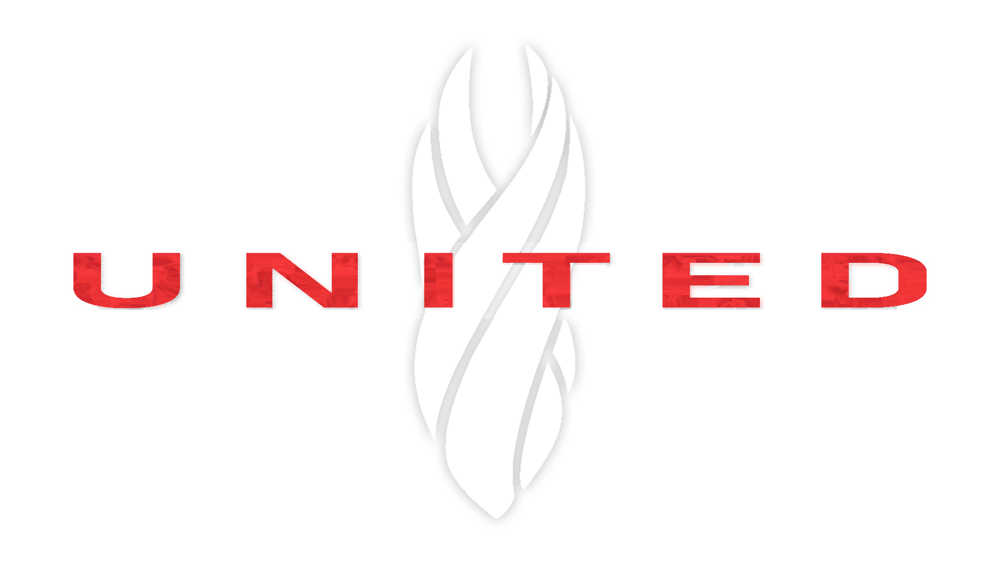
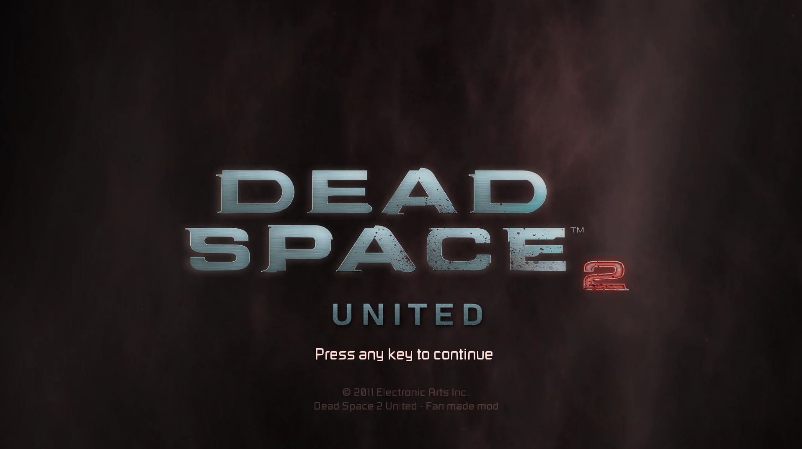
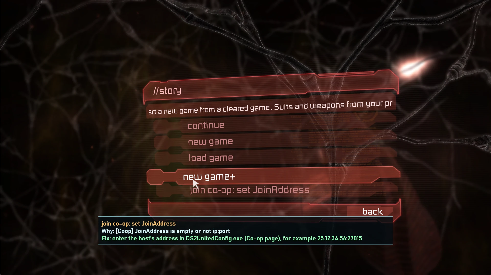
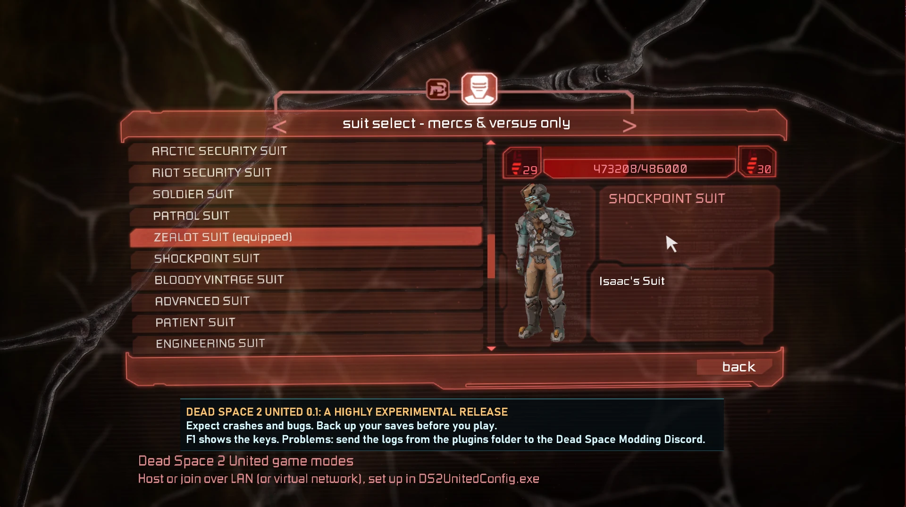
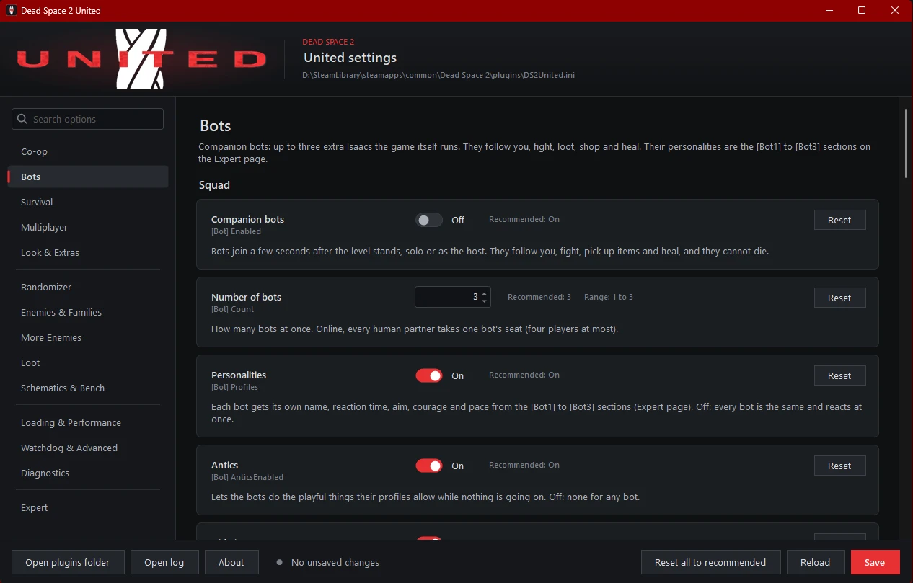

<p align="center">
  
</p>

> **Version 0.1 is a highly experimental release.** A lot of this has only been
> tested by a handful of people. Expect crashes and bugs, back up your saves,
> and send the logs when something breaks. The settings window and the main
> menu say so too.

# Dead Space 2 United

A mod for the PC port of Dead Space 2 that brings co-op to the story and adds
everything around it: survival game modes on the multiplayer maps and in
campaign arenas, companion bots, necromorph players invading the story, and the
enemy randomizer with more enemies per spawn. Every part works solo too, and
every part can be switched off on its own.
> **Story Co-op is still pretty broken. Expect lots of bugs.**

Nothing in the game's files is changed. The plugin runs on its own edition of
the [Marker Patch](https://github.com/Wemino/MarkerPatch), which loads it and
keeps the Marker Patch fixes that work with the mod, and everything happens in
memory while you play.

Before November 2026 this was the Co-op Mod (DS2Coop) and, earlier still, the
Dead Space 2 Randomizer.

<p align="center">
  
</p>
<p align="center">
  
  
</p>

## What it does

Everything except Invasion can be played solo and offline, and nearly every
part can be switched off or tuned in the settings window.

### Bots

Up to three AI companions who follow you and can do almost anything a player
can: shoot with every weapon, stomp, punch, use kinesis and stasis, loot, heal
and shop. They react to what happens around them, and each one can have its own
personality: name, favourite weapons and suits, aim, courage, pace and a bit of
trolling. Orders sit on the numpad (follow or hold, go there, attack target,
hold fire, attack or cover formation).

### Story mode

- **Co-op** for up to four players through the whole campaign, over LAN or a
  virtual network such as Tailscale, ZeroTier or Radmin. The host leads levels,
  checkpoints and enemies; doors, lifts and scenes wait for everybody.
> **Story Co-op is still pretty broken. Expect lots of bugs.**
- **Invasion** (experimental, off by default): a friend can join as a necromorph
  instead of a human and hunt the others during their playthrough.
- **Enemy randomizer**: every enemy spawn can become a different enemy, through
  the vent and at the spot the level authored, with the room's scripting still
  working. Seeded, so a seed always gives the same run. Enemies a story scene
  uses, or that the level kills by script, are left alone.
- **More enemies**: two, three or four where the level placed one, set per enemy
  type, with a hard cap and a budget. Off by default.
- **Severed enemies** from the DLC: twitchers and the Severed pregnant can show
  up in the campaign.
- **Schematic and workbench shuffle**, scaled ammo and credit pickups.

### Game modes

The multiplayer menu is replaced by game modes. They run on all seven
multiplayer maps (including the two Outbreak maps) and on nine arenas cut from
the campaign, which are small because the story levels are linear.

The Outbreak maps (Concourse and Academy) are optional. They need
`DS2DAT12.DAT` in the game folder, which comes with Mark's
[Dead Space 2 Multiplayer](https://www.nexusmods.com/deadspace2/mods/181).
Without it they are simply not in the map list. In co-op the map picker refuses
them while any player lacks the file.

- **Survival**: endless waves that get harder, a boss wave at 10, until the team
  runs out of lives.
- **Mercenaries**: as many kills as possible against the clock. Kills and time
  capsules around the map add seconds, lives are endless, the terminal is closed.
- **Objective**: the multiplayer maps' own objectives as PvE against hordes and
  a clock.
- **Hold the Zone**: capture one zone after another while necromorphs try to
  stop you.
- **Supply terminal** (V): suits, weapons, upgrades and gadgets for your
  credits, between waves or at any time if you allow it.
- **Gadgets**: a turret, a stasis mine and a heal field.
- **Progression** like the original multiplayer: XP for nearly everything that
  matters, unlocking suits and weapons as you play.
- **Dementia**, an optional survival mutator with a sanity meter and
  hallucinations.

### Customisation

- Colours for the RIG, inventory, HUD, stasis, kinesis, visor and the menus.
- `DS2UnitedConfig.exe`: every setting with an explanation, the recommended
  value and a warning when a combination does nothing or is risky.
- **F1** in the game shows every key of the mod.

<p align="center">
  
</p>

Every hook checks a byte signature before it is placed, and the log says which
ones went in. An unsupported build of the game is left alone.

## Install

**[Download the latest release](https://github.com/RichardHafer/DS2-United/releases/latest)**

The release brings everything, including its own edition of the
[Marker Patch](https://github.com/Wemino/MarkerPatch) as `dinput8.dll`. It
replaces an official Marker Patch, reads the same `MarkerPatch.ini` and keeps
its fixes and options, except six that work on the same game functions as the
mod; [third_party/MarkerPatch-United](third_party/MarkerPatch-United/README.md)
lists them and why. With the official Marker Patch loaded instead, the mod
stays off and says so.

Close the game and extract the archive into the Dead Space 2 folder, next to
`deadspace2.exe`:

```text
Dead Space 2/
|-- dinput8.dll                 (United's edition of the Marker Patch)
|-- DS2UnitedConfig.exe         (the settings window)
|-- plugins/
|   |-- DS2United.asi
|   `-- DS2United.ini
`-- randomizer/                 (enemy pool and the mod's own game data)
```

Updating from the Co-op Mod: delete `plugins\DS2Coop.asi` (or
`HaferSprawl.asi`). Your settings carry over: the settings window copies a
`DS2Coop.ini` to `DS2United.ini` the first time it opens, and the plugin
reads the old file until then. If the old plugin is still there, the new one
stays idle and says so in `plugins\DS2United.log`. An old INI keeps its own
key choices, so the terminal stays on B there until you change it.

Settings live in `plugins\DS2United.ini`. The easy way to change them is
`DS2UnitedConfig.exe`: every option with an explanation, the recommended
value, and a warning when a combination does nothing or is risky. It only
rewrites the values you changed and keeps a backup of the file.

Loading screens are a little longer than usual. The plugin keeps every enemy
template resident so any enemy can appear anywhere, and it holds the loading
screen until that pool is ready. That is on purpose.

The plugin writes `plugins\DS2United.log`, `DS2Randomizer.log` and
`DS2Bots.log` while the game runs. If something goes wrong, send those with
where you were. Co-op needs the same build of the plugin on every PC.

---

## How the bigger pieces work

Not required reading. This is here so the next person does not have to redo
the research. The comments in the source carry the evidence: addresses,
dumps, and the runs that proved or disproved an idea.

### Replacing an enemy

Every authored spawn goes through one engine function, `FuncSpawn::HandleEvents`.
It looks the spawn packet up by the target's GUID and hands it to the entity
factory. A hook between those two steps swaps the packet for one from a pool
of every enemy record in the game, so the factory builds the replacement
exactly the way it builds the original: same transform, same group, same
stream ownership.

The pool is a stream of the plugin's own, built offline from the game's
archives with every enemy record, its drop lists, dismemberment props and the
character packages they need. It is loaded once and stays resident, which is
why any enemy can appear in any chapter and why the loading screen waits for
it.

Vent spawns are the hard case. A vent arrival is a contract between the spawn
point and the spawning component of the enemy: which vent, which animation,
which spawn-done message. A replacement gets the source's spawning header
bound to its own component, so a Puker climbs out of the Leaper's ceiling vent
with the Leaper's arrival rules. Pairs that cannot be bound are refused rather
than guessed.

### Keeping the scripting alive

A scripted room does not count corpses. It counts death messages, and every
authored enemy carries the name of the message its room waits for. A
replacement carries its donor's name instead, from another chapter, which the
engine's message table does not even know. So the source's message is written
into the replacement's health component after creation, with the reference the
engine would have taken. When that write is impossible, the watchdog registers
the actor and says the message itself the first time the actor's state machine
shows the dead table.

The watchdog also tracks every replacement from creation. One that outlives
its leash is reported with its position; one that never became an NPC, or is
still running a vent state machine after the whole leash, has its death
message said for it; and with `WatchdogKill` on, the rest are killed through
the engine's own `SetHealth(0)`, on the game thread, with vtable and GUID
re-checked first.

One field is deliberately left alone: `MSG_AWARE`. It is the only one of the
four an actor listens for rather than sends, and rewriting it after creation
left listener nodes registered under the donor's hash with nobody behind them.
That was a dispatch crash six level segments later.

### More enemies

A repeat is produced exactly the way the engine produces its own queued retry:
a message carrying the spawner's trigger id, dispatched through the spawner's
own `HandleEvents`. The spawner's count is parked far below its authored
maximum for the duration and put back afterwards, and the per-spawn completion
message is hidden so level logic does not count the copies.

Vent copies are spaced two seconds apart, because a vent carries one enemy at
a time. That collided with retirement: a spawner whose authored maximum is one
is retired by the arrival's own `SpawnDone` and deleted, and two seconds later
there was nothing left to drive. So a hook just before `SpawnDone` parks the
count first, and the last copy lets the spawner retire the retail way.

A room that counts kills counts one per authored spawn: the first death of a
repeated group passes, the copies' deaths are swallowed at the dispatch.

The hard limit is not the multiplier. NavPower, the pathfinding library, gets
one fixed 576 KiB pool from the game, and past roughly 160 navigating enemies
it stops the process with "System ran out of available heap memory". The
plugin hands it a larger pool at creation (`NavPowerPoolKiB`).

### Extra spawns

A spawner is driven once more with the donor forced in the selection hook, and
the actor is moved to the spot the readout printed, the way `FuncSpawn` itself
moves a spawn onto its location entity. A spawner whose authored target is a
prop works too; the packet is swapped like any other. Area rules (`near:20`)
need no spawner at all: they fire on proximity and borrow whichever live
spawner still resolves its own target, preferring ones that spawn props.

### Zone switches at high frame rates

The pool depends on the stock character packages, and the level's stream sets
list the same packages. Whoever loads one first owns it. Above about 95 FPS the
level usually wins, because the pool request waits for a stream update. At the
next area switch the set wants to unload a package the pool still holds, the
package stays at status 3, and the set calls unload again every tick and loads
nothing new: an elevator that never arrives. The heal sits on that status test
and shows the set a package that only the pool still holds as unloaded. The
record stays loaded under the pool's reference, which is the state a capped
game ends up in anyway.

### Loot

Every pickup decides its amount once, in its constructor. A hook right after
that scales the instance, so the shared attribute block is never touched and
nothing is scaled twice. Credit chips are different: their worth is a span in
the shared block, drawn when the chip is picked up, so for those the span is
scaled once per block.

### Workbench shuffle

The game does not store an upgrade node's type on the node. Every consumer
turns the node's name hash into a type through one pure function, and one
inline hook on that function moves what a node awards while the grid, the
connections and the save data stay as authored. The amounts have to follow:
a Capacity cell that now awards Reload would otherwise hand you its 25 rounds
as 25 seconds. The trees are read once at install and every cell is rewritten
with the amount the tree authored for its new stat.

---

## Building

Visual Studio 2022 with the x86 toolchain and Python 3. `build_ds2coop.cmd`
builds `build\DS2United.asi`; `scripts\build_tests.cmd` and the other
`scripts\build_*_tests.cmd` build the unit tests. `tools\vcvars32.cmd` finds whichever edition is installed. safetyhook
needs `std::expected`, hence `/std:c++latest`.

`build_configurator.cmd` builds `DS2UnitedConfig.exe` with the C# compiler
that ships with Windows (.NET Framework 4), no SDK needed.
`build\DS2UnitedConfig.exe --selftest <copy of an INI>` edits that copy
through the same save path as the window and checks byte by byte that only the
edited values changed. Run it on a copy, never on the game's INI.

The `src/generated_*.h` tables are built from the extracted game data under
`analysis/`, which is not part of the repository; the headers are committed,
so the plugin builds without it. The enemy pool and the other game-derived
streams ship with the release, not with the code.

Addresses are specific to the Steam build. Signatures are matched at runtime,
so an unsupported build fails safely and reports what it could not find.

## Credits

Made by Richard Hafer.

- The [Dead Space Modding](https://discord.com/invite/sWMRkYJ5JV) community for research, tests and feedback
- [safetyhook](https://github.com/cursey/safetyhook) and [Zydis](https://github.com/zyantific/zydis) for hooking
- Wemino's [Marker Patch](https://github.com/Wemino/MarkerPatch), which the release ships in its own edition (GPL-2.0, source and patch in `third_party/MarkerPatch-United`)
- Mark de Rune's [Dead Space 2 Multiplayer](https://www.nexusmods.com/deadspace2/mods/181) for the Outbreak maps, the game mode row's menu screen and the work on bringing console data to the PC build
- Everyone who played test runs and sent logs

## Licence

MIT, see `LICENSE`. The Marker Patch edition in `third_party/MarkerPatch-United`
and the `dinput8.dll` built from it are GPL-2.0, like the Marker Patch itself.
Not affiliated with EA or Visceral Games.
